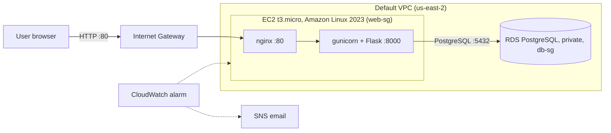

# Guestbook: a small database-driven app on AWS

A simple guestbook web app deployed on a Linux EC2 instance, backed by a private Amazon RDS PostgreSQL database. Built for the MangoApps DevOps Engineer take-home assignment.

**Live app:** http://[YOUR-PUBLIC-IP-OR-DOMAIN]/
**Health check:** http://[YOUR-PUBLIC-IP-OR-DOMAIN]/health
**Demo video:** [LINK]

## What it does

- `/` shows the latest 50 guestbook messages and a form to add one
- `POST /sign` saves a message to PostgreSQL
- `/health` returns `200 {"app":"ok","database":"ok"}` when the app can reach the database, and `503 {"app":"ok","database":"down"}` when it can't

## Architecture




**Request path:** browser → internet gateway → nginx on EC2 (port 80) → gunicorn/Flask on localhost:8000 → RDS PostgreSQL (port 5432, only reachable from the web security group) → response back the same way.

## Stack and why

| Choice | Why | Alternative considered |
|---|---|---|
| EC2 `t3.micro`, Amazon Linux 2023 | Free-tier eligible, plenty for a tiny app; AL2023 is AWS-maintained and patched | Ubuntu (larger community, but I wanted AWS-tuned packages and `dnf`/SSM defaults) |
| RDS PostgreSQL (`db.t4g.micro`) | Managed patching and backups, private subnet access only | Postgres on the same EC2 (cheaper but I'd own backups/patching); DynamoDB (doesn't fit relational data as naturally) |
| nginx + gunicorn | nginx handles port 80 and buffering; gunicorn runs the Flask app as a proper production server | Flask dev server (not production-safe); an ALB (costs money and isn't needed for one instance) |
| systemd service | Starts on boot and restarts on crash | Running gunicorn by hand or in tmux |

## Security

- **No secrets in the repo.** DB credentials live in `/etc/guestbook.env` on the server (`chmod 600`, loaded by systemd). `.env` is in `.gitignore`.
- **Security groups:**
  - `web-sg`: HTTP 80 from anywhere; SSH 22 from my IP only
  - `db-sg`: PostgreSQL 5432 **only from `web-sg`**
- **RDS is not publicly accessible.**
- **Code:** parameterized SQL queries, Jinja auto-escaping of user input, input length limits.
- MFA on the root account and a non-root IAM user for day-to-day work.

## Cost control (free tier)

- AWS Budget with an email alert set before creating any resources
- Single `t3.micro` instance, 8 GB volume
- RDS `db.t4g.micro`, 20 GB, Multi-AZ off, Performance Insights and Enhanced Monitoring off
- No load balancer, NAT gateway, or other always-on paid services

## Extras I chose

- **[CloudWatch alarm + SNS email]**: [one sentence on why, e.g. "I want to know the instance is unhealthy before a customer does."]
- **[Optional second extra, e.g. GitHub Actions deploy]**: [one sentence on why]

## Run locally

```bash
python3 -m venv venv && source venv/bin/activate
pip install -r requirements.txt

# start a throwaway Postgres
docker run -d --name pg -e POSTGRES_PASSWORD=dev -e POSTGRES_DB=guestbook -p 5432:5432 postgres:16

export DB_HOST=localhost DB_NAME=guestbook DB_USER=postgres DB_PASSWORD=dev
flask --app app run
```

Open http://127.0.0.1:5000.

## How I deployed it

1. **Account setup:** MFA, IAM user, and a billing budget alert.
2. **Security groups:** created `web-sg` and `db-sg` (rules above).
3. **RDS:** PostgreSQL, free-tier template, private, initial DB name `guestbook`, attached to `db-sg`.
4. **EC2:** launched Amazon Linux 2023 `t3.micro` with `web-sg` and a key pair.
5. **Install and clone:**
   ```bash
   sudo dnf install -y git python3-pip nginx
   git clone https://github.com/[YOU]/[REPO].git ~/app && cd ~/app
   python3 -m venv venv && source venv/bin/activate
   pip install -r requirements.txt
   ```
6. **Secrets** in `/etc/guestbook.env` (`DB_HOST`, `DB_NAME`, `DB_USER`, `DB_PASSWORD`), `chmod 600`.
7. **systemd unit** `/etc/systemd/system/guestbook.service` runs `gunicorn -w 2 -b 127.0.0.1:8000 app:app` with `EnvironmentFile=/etc/guestbook.env` and `Restart=always`.
8. **nginx** reverse proxy on port 80 to `127.0.0.1:8000` (the default server block in `nginx.conf` was commented out to avoid a conflict).
9. `sudo systemctl enable --now guestbook nginx`
10. Verified with `curl http://127.0.0.1:8000/health`, then the public URL.

## Troubleshooting notes

- Service logs: `sudo journalctl -u guestbook -n 50 --no-pager`
- nginx config check: `sudo nginx -t`
- DB reachability from EC2: `nc -zv <rds-endpoint> 5432`

## What I'd change before real customers

- HTTPS (ACM certificate behind an Application Load Balancer, or Let's Encrypt)
- Two or more instances across AZs behind an ALB with an Auto Scaling group
- RDS Multi-AZ, automated backups, and a tested restore
- Secrets in AWS Secrets Manager or SSM Parameter Store instead of an env file
- Infrastructure as code (Terraform or CloudFormation) and a CI/CD pipeline
- Centralized logs and metrics, plus more alarms (5xx rate, DB connections, disk)
- SSH replaced by SSM Session Manager (no open port 22)
- Rate limiting and CSRF protection on the form
